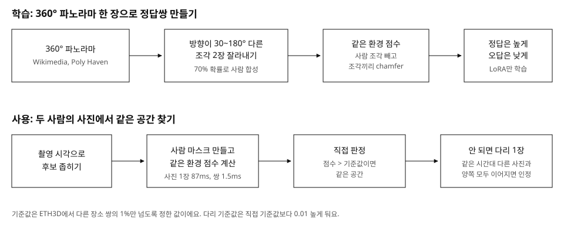
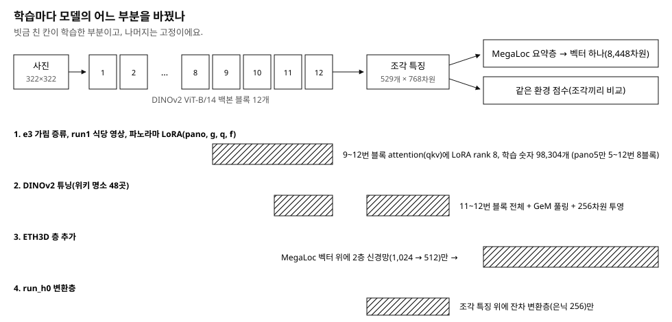
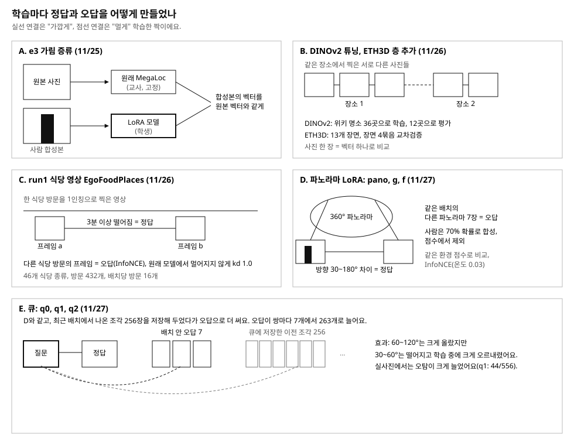
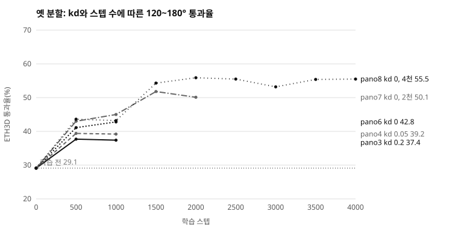
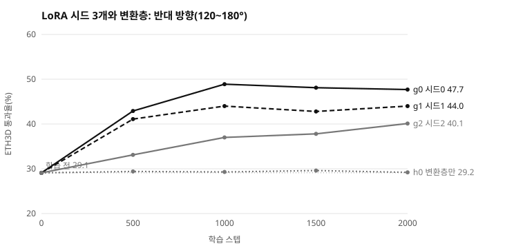
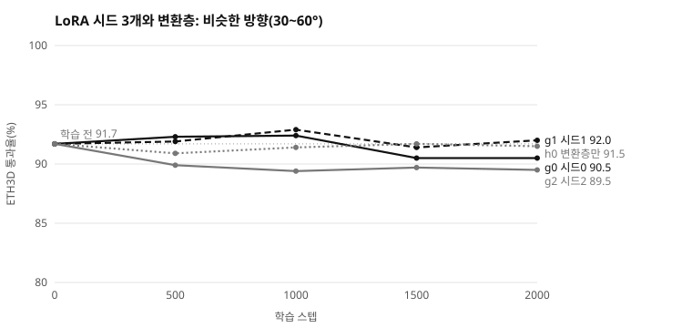
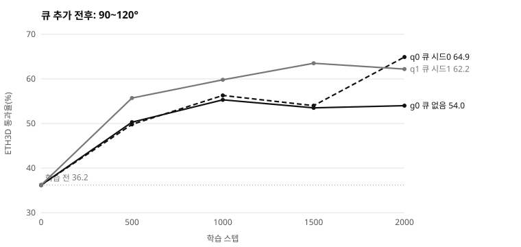
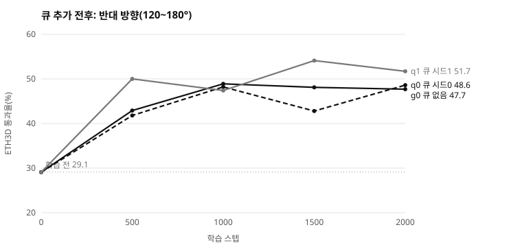
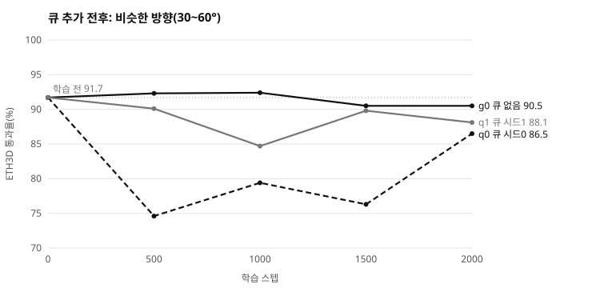

# 잇기: 같은 공간 판정 모델 학습 기록 (11/25~11/27)

잇기 기능에서 "두 사람이 같은 공간에서 찍은 사진인지"를 판단하는 모델을 우리 목적에 맞게 바꾸려고 진행한 학습을 모두 정리했어요. 사흘 동안 학습 방식 7가지로 20번 넘게 학습했고(시험 실행과 교차검증 제외), 학습마다 무엇을, 어떤 데이터로, 어떻게 학습했고 결과가 어땠는지 적었어요. 처음 보는 사람도 따라올 수 있게 용어부터 설명해요.

## 목차

1. [한눈에 보기](#한눈에-보기)
2. [용어](#용어)
3. [무엇을 풀려는가](#무엇을-풀려는가)
4. [학습 전체 목록](#학습-전체-목록)
5. [학습 1. e3 가림 증류](#학습-1-e3-가림-증류-1125)
6. [학습 2. DINOv2 튜닝](#학습-2-dinov2-튜닝-1126)
7. [학습 3. run1 식당 영상 LoRA](#학습-3-run1-식당-영상-lora-1126)
8. [학습 4. ETH3D 층 추가](#학습-4-eth3d-층-추가-1126)
9. [전환점: 같은 환경 점수](#전환점-같은-환경-점수)
10. [학습 5. 파노라마 LoRA, 옛 분할 8번](#학습-5-파노라마-lora-옛-분할-8번-1127)
11. [학습 6. 파노라마 LoRA, 새 분할](#학습-6-파노라마-lora-새-분할-1127)
12. [학습 7. 큐](#학습-7-큐-1127)
13. [실사진 평가](#실사진-평가)
14. [판단 규칙 실험](#판단-규칙-실험-학습-없음)
15. [다음 학습: 식당, 카페, 야외 데이터](#다음-학습-식당-카페-야외-데이터)
16. [결론과 남은 작업](#결론과-남은-작업)
17. [파일](#파일)

## 한눈에 보기

- 원래 MegaLoc은 사진 한 장을 벡터 하나로 요약해 비교해요. 서로 반대 방향(120~180°)에서 찍은 같은 공간을 17%만 맞혀요.
- 앞의 학습 4가지(가림 증류, DINOv2 튜닝, 식당 영상, 층 추가)는 효과가 없거나 오히려 나빠졌어요. 데이터가 "크게 다른 방향에서 본 같은 공간"이라는 목적과 맞지 않았기 때문이에요.
- 사진을 조각으로 나눠 사람 조각은 빼고 배경 조각끼리 비교하는 **같은 환경 점수**로 바꾸자, 학습 없이 29%가 됐어요.
- 360° 파노라마로 정답쌍을 자동으로 만들어 LoRA를 학습하자 48% 안팎까지 올랐어요(시드 3개 평균 43.9%).
- 팀이 찍은 실사진 36장에서 학습 모델(run_g0)은 같은 장소 74쌍 중 53쌍을 찾았고, 다른 장소 556쌍 중 오탐은 4쌍이었어요. 같은 시간대 다른 사진을 다리로 쓰는 규칙을 더하면 58쌍, 오탐 6쌍이에요.
- 큐 방식은 ETH3D 숫자는 가장 좋았지만 실사진 오탐이 크게 늘어 보류했어요.
- 학습 데이터에 식당, 카페가 거의 없다는 문제를 찾아, 식당, 카페, 야외 파노라마 99장을 모아 다음 학습을 걸어 뒀어요.

## 용어

| 용어 | 뜻 |
| --- | --- |
| MegaLoc | 공개된 장소 인식 모델이에요. DINOv2(ViT-B/14) 백본 위에 사진을 벡터 하나(8,448차원)로 요약하는 층이 붙어 있어요. |
| 백본, 블록 | 사진에서 특징을 뽑는 본체예요. ViT-B/14는 같은 구조의 블록 12개를 차례로 통과해요. |
| 패치(조각) | 백본이 사진을 14×14 픽셀 단위로 나눈 조각이에요. 322×322 입력이면 23×23 = 529개이고, 조각마다 768차원 특징이 나와요. |
| 같은 환경 점수 | 사진 A의 각 조각이 사진 B에서 가장 닮은 조각과 얼마나 닮았는지 평균하고, 반대 방향도 구해 둘을 평균한 값이에요(chamfer 유사도). 사람 조각은 빼요. |
| LoRA | 큰 모델은 그대로 두고 일부 층에 작은 보정 행렬만 붙여 학습하는 방법이에요. 학습할 숫자가 적어 데이터가 적어도 덜 망가져요. |
| InfoNCE | "정답 짝의 점수가 오답들보다 높아지도록" 학습하는 손실이에요. 온도(tau)가 작을수록 차이를 더 날카롭게 봐요. |
| kd(증류항) | 학습 중인 모델의 특징이 원래 모델에서 너무 멀어지지 않게 잡아 두는 항이에요. 가중치 0이면 끈 거예요. |
| 정답쌍, 오답쌍 | 같은 장소 두 사진이 정답쌍, 다른 장소 두 사진이 오답쌍이에요. |
| ETH3D | 실내외 장면 13개를 여러 방향에서 찍고 카메라 방향을 기록한 공개 데이터예요(사진 454장, 정답쌍 9,222개). 각도별 성능을 잴 수 있어 주 평가로 썼고, 마지막 학습들에는 쓰지 않았어요. |
| 기준선(오탐 1%) | 다른 장소 쌍 2만 개 점수의 상위 1% 값을 기준값으로 정하고, 같은 장소 쌍이 이 값을 넘은 비율을 성능으로 봐요. "다른 장소를 100번에 1번만 잘못 붙일 때 같은 장소를 얼마나 찾나"예요. |
| 시드 | 학습의 무작위 순서를 정하는 숫자예요. 설정이 같아도 시드에 따라 결과가 흔들려요. |
| 스텝 | 배치 하나로 모델을 한 번 고치는 단위예요. |

## 무엇을 풀려는가

잇기는 두 사람의 사진첩에서 함께한 순간을 찾는 기능이에요. 먼저 촬영 시각으로 후보를 좁히고, 남은 사진 쌍이 같은 공간인지 판단해요.

- 시간으로 먼저 거르기 때문에, 판단할 때 경쟁하는 오답은 "같은 시각에 있었던 전혀 다른 장소"예요.
- 그래서 정확히 같은 지점이 아니어도 같은 실내 환경(재질, 조명, 가구)이면 같은 공간으로 봐도 돼요. 일반 장소 인식과 다른 점이에요.
- 어려운 경우는 마주 앉아 서로를 찍은 사진이에요. 방향이 정반대라 함께 보이는 배경이 적고, 사람이 화면을 크게 가려요.

## 학습 전체 목록

| 날짜 | 학습 | 횟수 | 데이터 | 학습한 부분 | 결과 |
| --- | --- | ---: | --- | --- | --- |
| 11/25 | 1. e3 가림 증류 | 1 | 사람 합성 사진 306쌍 | LoRA | 사람 영역만 가려도 같은 효과라 학습 이득 없음 |
| 11/26 | 2. DINOv2 튜닝 | 1 | 위키 명소 48곳 599장 | 마지막 2블록, 출력층 | 우연 수준(R@1 +2.7%p) |
| 11/26 | 3. run1 식당 영상 | 1 | EgoFoodPlaces 방문 432개 | LoRA | 우연 수준(R@1 +0.6%p) |
| 11/26 | 4. ETH3D 층 추가 | 4겹 | ETH3D 13장면 | 출력 위 2층 | 크게 악화 |
| 11/27 | 5. 파노라마 LoRA, 옛 분할 | 8 | 파노라마 310장 | LoRA | kd를 끄자 120~180° 29% → 50% |
| 11/27 | 6. 파노라마 LoRA, 새 분할 | 4 | 파노라마 306장 | LoRA 또는 변환층 | LoRA 시드 3개 평균 43.9% |
| 11/27 | 7. 큐 | 3 (+시험 1) | 6과 같음 | LoRA | ETH3D 최고, 실사진 오탐 급증 |
| 11/27 | 다음: 식당, 카페, 야외 추가 | 2 (예정) | 파노라마 + 99장 | LoRA | 학습 대기 |

모든 학습은 맥미니 M4(MPS)에서 돌렸어요.

---

## 학습 1. e3 가림 증류 (11/25)

**목적**: 사람이 화면을 가려도 사진 벡터가 흔들리지 않게 만들기.

**데이터**
- KAN-10에서 만든 합성 데이터 [occlusion-train-v2](../2026-11-25-linking-occlusion-train-data/README.md)예요. 공개 배경 사진 51장에 인물 컷아웃 13명을 붙여 306쌍을 만들었어요.
- 가림 비율은 10~25%, 25~40%, 40~60% 세 구간이에요.
- 평가는 학습에 쓰지 않은 배경 6장, 인물 3명으로 만든 31쌍이에요.

**방법**
- 원래 MegaLoc을 교사로 고정하고, LoRA를 붙인 MegaLoc을 학생으로 둬요.
- 학생이 사람 합성본을 보고 낸 벡터가 교사가 원본을 보고 낸 벡터와 같아지도록 학습해요. 원본을 넣었을 때도 원래 벡터를 유지하게 했어요.
- 손실: 0.5 × (1 − cos(학생(합성본), 교사(원본))) + 0.5 × (1 − cos(학생(원본), 교사(원본)))
- LoRA: 9~12번 블록 qkv, rank 8, 학습 숫자 98,304개
- 설정: 5에폭(765스텝), 배치 2, 학습률 1e-4, 4분 35초

**결과** (원본 벡터와의 cos 유사도, 높을수록 가림에 강함)

| 가림 구간 | 학습 전 | 학습 없이 사람 영역만 가림 | LoRA 학습 후 |
| --- | ---: | ---: | ---: |
| 작게(12쌍) | 0.796 | 0.857 | 0.852 |
| 중간(10쌍) | 0.667 | 0.737 | 0.736 |
| 크게(9쌍) | 0.543 | 0.607 | 0.610 |

**판단**: 학습 효과가 사람 영역을 가리기만 한 것과 같아요. 학습 없이 마스크로 해결되는 문제라 이 방향은 접었어요. 1순위 검색은 학습 전에도 모두 맞혀서 차이가 없었어요.

## 학습 2. DINOv2 튜닝 (11/26)

**목적**: 점 매칭(LightGlue)이 놓친 크게 다른 시점의 같은 장소를, 사진 전체 비교로 잡도록 DINOv2를 튜닝하기.

**데이터**
- Wikimedia에서 모은 한국, 일본, 대만의 명소와 생활 공간 48곳, 사진 599장이에요(경회루, 홍대, 일본 카페 실내 등).
- 장소 36곳으로 학습하고, 학습에 쓰지 않은 12곳(질의 151개)으로 평가했어요. 같은 사람이 올린 사진은 비교 후보에서 뺐어요(같은 날 연달아 찍은 거의 같은 사진을 피하려는 거예요).
- 실제 사진 확인용으로 PC방 쌍과 고깃집 쌍도 함께 봤어요.

**방법**
- 원본 DINOv2의 앞쪽 10블록은 고정하고 결과를 미리 저장했어요. 마지막 2블록, GeM 풀링, 256차원 투영층만 학습해요.
- 한 배치에 장소 8곳, 장소마다 사진 최대 4장을 넣고 같은 장소끼리 가까워지게 학습했어요(대조 학습, 온도 0.07).
- 학습률: 블록 1e-5, 풀링과 투영층 1e-3. 300번 반복.

**결과**

| | 1순위 정답률 | mAP | PC방 쌍 순위(정방향/역방향) | 고깃집 순위 |
| --- | ---: | ---: | --- | --- |
| 튜닝 전 | 71.5% | 0.495 | 1위 / 2위 | 1위 |
| 튜닝 후 | 74.2% | 0.510 | 1위 / 8위 | 1위 |

**판단**: 2.7%p는 질의 151개 중 4개 차이라 우연과 구분되지 않아요. PC방 쌍은 학습 중 1위, 7위, 1위, 2위로 오락가락했어요. 장소 36곳은 너무 적고, 명소 위주라 생활 공간과 달랐어요. 그래서 이미 수만 곳으로 학습된 MegaLoc에서 출발하기로 했어요.

## 학습 3. run1 식당 영상 LoRA (11/26)

**목적**: MegaLoc이 같은 식당 안에서 시점이 바뀐 사진을 더 잘 맞히도록 학습하기.

**데이터**
- EgoFoodPlaces는 식당 방문을 1인칭으로 찍은 영상 데이터예요. 학습용 식당 종류 46개, 방문 432개를 썼고 평가용과 겹치지 않아요.
- 같은 방문에서 3분 이상 떨어진 프레임 두 장을 정답쌍으로 써요. 거의 같은 장면은 빼려는 거예요.
- 배치 안 다른 식당 방문의 프레임이 오답이에요.

**방법**
- MegaLoc 9~12번 블록 qkv에 LoRA(rank 8)를 붙여요.
- 손실: 벡터 기준 InfoNCE(온도 0.05) + kd 1.0
- 설정: 600스텝, 배치당 방문 16개, 학습률 1e-4, 스텝당 2.75초(약 28분)

**결과**

| 스텝 | Ego R@1 | Ego R@5 | EPFL R@1 |
| ---: | ---: | ---: | ---: |
| 0 | 0.800 | 0.884 | 0.910 |
| 200 | 0.799 | 0.885 | 0.913 |
| 400 | 0.804 | 0.893 | 0.913 |
| 600 | 0.806 | 0.894 | 0.913 |

Ego는 질의 3,080개예요.

**판단**: 효과가 없었어요. 식당 영상은 걸어 다니며 찍어 프레임 사이 시점 변화가 작고, kd 1.0이 모델을 원래 자리에 붙잡아 두었어요.

## 학습 4. ETH3D 층 추가 (11/26)

**목적**: MegaLoc은 그대로 두고, 출력 벡터 위에 작은 층을 붙여 큰 각도 쌍만 보정하기.

**데이터**
- ETH3D 13개 장면을 장소 단위로 4묶음으로 나눠, 3묶음으로 학습하고 남은 1묶음으로 평가했어요(4겹 교차검증).
- 정답쌍은 같은 장면 안의 사진 쌍이에요. 방향 차이와 겹침 정도가 함께 기록돼 있어요.

**방법**
- 고정한 MegaLoc 벡터(8,448차원) 위에 2층 신경망(8,448 → 1,024 → 512)을 학습해요.
- 배치 64쌍, InfoNCE(온도 0.05), AdamW 학습률 1e-3, 1,500스텝, 겹마다 처음부터 다시 학습해요.

**결과** (학습에 안 쓴 장면, 그 묶음 안에서 잡은 오탐 1% 기준선)

| 방향 차이 | MegaLoc 그대로 | 층 추가 |
| --- | ---: | ---: |
| 0~30° | 99.4 | 76.1 |
| 30~60° | 97.7 | 61.6 |
| 60~90° | 72.0 | 37.0 |
| 90° 이상 | 59.9 | 25.9 |

**판단**: 학습 장면이 9~10개뿐이라 층이 그 장면을 외웠고, 처음 보는 장면에서는 MegaLoc의 일반성까지 잃었어요. 이 표의 MegaLoc 값이 다른 표보다 높은 건 기준값을 평가 묶음 안의 오답만으로 잡았기 때문이에요.

## 전환점: 같은 환경 점수

앞의 실패에서 두 가지를 배웠어요.
- 학습 데이터가 "크게 다른 방향에서 본 같은 공간"이어야 해요.
- 시간으로 먼저 거르므로, 정확히 같은 지점이 아니라 같은 실내 환경을 맞히면 돼요.

그래서 학습 없이 점수 계산부터 바꿨어요. MegaLoc의 벡터 하나 대신 조각 529개끼리 비교하는 같은 환경 점수예요(ETH3D, 오탐 1% 기준선, %).

| 방향 차이 | MegaLoc 벡터 | 같은 환경 점수(MegaLoc 조각) | 같은 환경 점수(원본 DINOv2 조각) |
| --- | ---: | ---: | ---: |
| 0~30° | 96.2 | 98.6 | 93.7 |
| 30~60° | 83.0 | 91.7 | 75.5 |
| 60~90° | 39.3 | 51.4 | 46.7 |
| 90~120° | 26.7 | 36.2 | 36.2 |
| 120~180° | 17.2 | 29.1 | 31.0 |

모든 구간이 올랐고, MegaLoc 조각이 원본 DINOv2보다 작은 각도에서 훨씬 나아서 이후 학습은 모두 MegaLoc 조각과 같은 환경 점수로 했어요.

## 학습 5. 파노라마 LoRA, 옛 분할 8번 (11/27)

**목적**: 같은 환경 점수 자체를 학습 목표로 삼아, 크게 다른 방향의 같은 공간 점수를 올리기.

**데이터 만드는 법** (그림 D)
1. 360° 파노라마 한 장에서 방향이 30~180° 다른 두 곳을 휴대폰 사진처럼 잘라내요. 위아래 기울기 ±10°, 화각 60~80°예요(`train/pano_crop.py`).
2. 두 조각은 같은 공간, 같은 순간이라 정답이 확실해요. 사람이 표시할 필요가 없어요.
3. 조각마다 70% 확률로 사람 사진을 합성해요. 화면을 가리는 비율은 촬영 계획(occlusion-v2)을 따랐어요.

   | 구간 | 화면 면적 | 뽑힐 확률 |
   | --- | --- | ---: |
   | 원경 | 5~12% | 20% |
   | 중간 | 12~25% | 30% |
   | 근접 | 25~40% | 30% |
   | 크게 | 40~70% | 20% |

   위치는 왼쪽, 가운데, 오른쪽 중 하나예요. 합성한 사람 영역은 마스크로 표시해 점수에서 빼요.
4. 한 배치는 파노라마 8장, 조각 16장이에요. 같은 배치 다른 파노라마의 조각 7개가 오답이에요.

**데이터 출처**
- Wikimedia Commons 자유 라이선스 실내 파노라마와 Poly Haven(CC0) 실내 HDRI예요.
- 하늘이 넓은 야외 파노라마 80장은 뺐어요. 하늘 조각은 어느 야외에서나 서로 닮아 점수를 오염시키기 때문이에요.
- 학습 310장, 평가 31장을 파일 단위로 나눴어요. 나중에 이 분할에 누수가 있는 걸 발견했어요(학습 6 참고).

**방법**
- LoRA: 9~12번 블록 qkv, rank 8
- 손실: 같은 환경 점수 기준 InfoNCE(온도 0.03) + kd × (조각 특징과 벡터가 원래 모델에서 멀어진 정도)
- AdamW, 학습률 1e-4, 처음 50스텝 워밍업 후 cosine 감소, 500스텝마다 평가
- 스텝당 약 2.3초(1,000스텝 약 39분)

**8번의 학습** (ETH3D, %)

| run | 바꾼 것 | 스텝 | 30~60° | 60~90° | 90~120° | 120~180° |
| --- | --- | ---: | ---: | ---: | ---: | ---: |
| 학습 전 | | | 91.7 | 51.4 | 36.2 | 29.1 |
| run_pano1 | kd 1.0 | 1,500 | 93.0 | 55.8 | 40.2 | 30.6 |
| run_pano2 | kd 1.0, 어려운 오답 50% | 1,000 | 91.8 | 54.4 | 40.2 | 30.6 |
| run_pano3 | kd 0.2 | 1,000 | 94.0 | 59.2 | 46.5 | 37.4 |
| run_pano4 | kd 0.05 | 1,000 | 94.3 | 60.8 | 48.8 | 39.2 |
| run_pano5 | kd 0.05, LoRA 8블록 | 1,000 | 93.3 | 59.8 | 47.7 | 38.5 |
| run_pano6 | kd 0 | 1,000 | 93.9 | 61.0 | 50.9 | 42.8 |
| run_pano7 | kd 0 | 2,000 | 93.3 | 63.9 | 56.5 | 50.1 |
| run_pano8 | kd 0 | 4,000 | 91.4 | 61.8 | 56.4 | 55.5 |

- 어려운 오답(run_pano2): 배치를 무작위가 아니라 서로 비슷한 파노라마 20개 이웃 중에서 고르는 방식이에요. 효과가 없었어요.
- kd를 1.0 → 0.2 → 0.05 → 0으로 줄일수록 큰 각도가 꾸준히 올랐어요. 원래 모델에 붙잡아 두는 힘이 학습을 막고 있었어요.
- LoRA를 8블록으로 늘려도(run_pano5) 나아지지 않았어요.
- 스텝을 늘리면 120~180°는 올랐지만 30~60°는 조금 내려갔어요. 다만 이 차이는 학습 6의 시드 흔들림 안에 들어가요.

## 학습 6. 파노라마 LoRA, 새 분할 (11/27)

**옛 분할의 문제**
- 같은 장소를 여러 장 찍은 파노라마가 학습과 평가에 나뉘어 들어가 평가가 부풀려질 수 있었어요.
- Wikimedia에 다시 올라온 Poly Haven 사진이 중복으로 들어 있었어요.
- 같은 장소의 다른 파노라마가 한 배치에서 서로 오답이 되는 문제도 있었어요.

**새 분할** (`--group 1`, `train/pano_groups.py`)
- 같은 장소 파노라마를 한 그룹으로 묶고(421장 → 199그룹), 그룹 단위로 학습 306장, 평가 28장을 나눴어요.
- 중복된 Poly Haven 사진 7장을 뺐어요.
- 같은 그룹의 다른 파노라마는 오답에서 빼요.
- 학습 방법은 학습 5의 가장 좋은 설정과 같아요(LoRA 4블록, kd 0, 2,000스텝).

**학습 전 비교 기준** (학습 없이 평가만)

| | 30~60° | 60~90° | 90~120° | 120~180° |
| --- | ---: | ---: | ---: | ---: |
| MegaLoc 조각 | 91.7 | 51.4 | 36.2 | 29.1 |
| 원본 DINOv2 조각 | 75.5 | 46.7 | 36.2 | 31.0 |

**4번의 학습** (ETH3D, %)

| run | 설정 | 0~30° | 30~60° | 60~90° | 90~120° | 120~180° | 시간 |
| --- | --- | ---: | ---: | ---: | ---: | ---: | ---: |
| run_g0 | LoRA, 시드 0 | 98.9 | 90.5 | 62.0 | 54.0 | 47.7 | 56분 |
| run_g1 | LoRA, 시드 1 | 99.2 | 92.0 | 61.3 | 51.0 | 44.0 | 56분 |
| run_g2 | LoRA, 시드 2 | 98.7 | 89.5 | 57.1 | 48.7 | 40.1 | 56분 |
| run_h0 | 백본 고정, 조각 위 변환층만 | 99.3 | 91.5 | 55.6 | 39.1 | 29.2 | 49분 |

run_h0의 변환층은 조각 특징(768차원)마다 같은 작은 잔차 신경망(768 → 256 → 768)을 거치게 해요. 처음에는 출력이 0이라 원래 특징과 같아요.

**판단**
- LoRA 학습 효과는 확실해요. 가장 낮은 시드도 90~120°가 +12.5점, 120~180°가 +11.0점이에요.
- 시드만 바꿔도 120~180°가 7.6점까지 흔들려요. 학습 5에서 본 "스텝을 늘리면 좋아진다"는 효과는 이 흔들림 안이라 근거로 쓰지 않아요.
- 30~60°는 시드 평균 90.7로 학습 전(91.7)보다 약 1점 낮아요. 비슷한 방향에서 찍는 포토스팟 상황이라 작은 회귀로 지켜봐요.
- 변환층만 학습(run_h0)은 큰 각도에서 효과가 거의 없었어요. 백본 안쪽을 바꿔야 해요.

## 학습 7. 큐 (11/27)

**목적**: 한 배치의 오답이 7개뿐이라 학습 신호가 약할 수 있어, 오답을 늘려 보기.

**방법** (그림 E, `train/train_pano_q.py --queue 256`)
- 학습 6과 같은 설정에, 최근 배치에서 나온 조각 256장을 저장해 두었다가 오답으로 더 써요. 쌍마다 오답이 7개에서 263개로 늘어요.
- 처음 200스텝은 큐 없이 학습하고, 그 뒤부터 큐를 써요. 큐의 조각은 저장 당시 모델로 계산한 값이에요.
- 같은 그룹의 조각은 큐에서도 오답으로 쓰지 않아요.
- 처음에는 메모리 부족으로 멈춰서, 큐와의 비교를 8장씩 나눠 계산하고 블록 활성값을 저장하지 않고 다시 계산하는 방식(`--gc 1`, 결과 동일)으로 바꿨어요. 그래서 스텝당 약 3.2초, 2,000스텝에 약 1시간 45분이 걸려요.
- 40스텝 시험 실행(run_qsmoke)으로 동작을 먼저 확인했어요.

**결과** (ETH3D, %)

| run | 0~30° | 30~60° | 60~90° | 90~120° | 120~180° |
| --- | ---: | ---: | ---: | ---: | ---: |
| run_g0(큐 없음) | 98.9 | 90.5 | 62.0 | 54.0 | 47.7 |
| run_q0(큐, 시드 0) | 97.4 | 86.5 | 74.3 | 64.9 | 48.6 |
| run_q1(큐, 시드 1) | 97.8 | 88.1 | 69.3 | 62.2 | 51.7 |
| run_q2(큐, 시드 2) | 이 PR을 올릴 때 학습 중 | | | | |

**판단**
- 60~120°가 run_g0보다 10점 넘게 올랐어요. 큐로 오답이 늘어난 효과가 분명해요.
- 대신 30~60°가 떨어졌고, 학습 중 값이 크게 오르내렸어요. run_q0의 30~60°는 500스텝 74.6, 1,000스텝 79.4, 1,500스텝 76.3, 2,000스텝 86.5였어요.
- 기준값도 크게 바뀌었어요(run_g0 0.629, run_q0 0.869). 점수가 전체적으로 높은 쪽에 몰렸다는 뜻이에요.
- 실사진에서는 오탐이 크게 늘었어요(다음 절). 그래서 큐는 보류했어요.

## 실사진 평가

ETH3D 숫자가 실제 사용 장면으로 이어지는지 보려고 팀이 직접 찍은 사진으로 평가했어요. **개인 사진이라 사진과 파일 이름은 올리지 않고 결과만 적어요.** 학습에는 전혀 쓰지 않았어요.

- 1차 24장: 장소 5곳(식당 10장, 지하철 승강장 4장, 스터디카페 6장, 고깃집 2장, PC방 2장). 같은 장소 68쌍, 다른 장소 208쌍이에요.
- 2차 36장: 사람이 크게 나온 사진 12장(식당 3곳, 술집 2곳, 카페 1곳)을 더했어요. 같은 장소 74쌍, 다른 장소 556쌍이에요.
- 사람 영역은 macOS Vision의 인물 분할로 마스크를 만들었어요. 친구 셀카처럼 배경이 거의 없는 사진은 후보에서 빼기로 한 유형이라, 놓쳐도 되는 경우로 봐요.
- 기준값은 실사진에 맞추지 않고 ETH3D에서 정한 값을 그대로 써요.

| 모델 | 평가셋 | 같은 장소 찾음 | 오탐 |
| --- | --- | ---: | ---: |
| 학습 전 | 24장 | 36/68 | 0/208 |
| run_g0 | 24장 | 48/68 | 2/208 |
| run_g0 | 36장 | 53/74 | 4/556 |
| run_q0 | 36장 | 54/74 | 8/556 |
| run_q1 | 36장 | 64/74 | 44/556 |

- 학습 모델이 실사진에서도 더 많이 찾아요. 처음 사진 6장만으로 봤을 때는 차이가 안 보였는데, 사진을 늘리자 분명해졌어요.
- run_q1은 ETH3D에서 가장 좋았지만 실사진 오탐이 run_g0의 11배예요. 큐 모델은 점수 분포가 시드마다 달라 ETH3D 기준값이 실사진으로 옮겨지지 않아요.
- 오탐은 모두 식당, 술집 실내끼리였어요(따뜻한 조명, 나무 재질). 날짜가 달라 실제로는 시간 필터에서 걸러지는 쌍이지만, 같은 시간대에 비슷한 식당 두 곳에 있었다면 생길 수 있어요.
- 조각별로 가장 닮은 짝을 이어 보면(`eval/viz_matches.py`), 학습 모델은 특정 물건보다 나무 바닥, 흰 천장, 책상 같은 재질이 맞는 곳에 높은 점수를 줘요.

## 판단 규칙 실험 (학습 없음)

### 흔한 패턴 깎기: 채택 안 함

어느 장소에나 나오는 흔한 조각(나무, 흰 벽)의 점수를 깎아 봤어요(`eval/common_discount.py`). 외부 파노라마 31장에서 자른 조각 200장으로 "흔한 패턴 은행"을 만들고, 은행과 닮은 정도에 비례해 깎았어요.

| run_g0, 깎는 세기 | 0 | 0.25 | 0.5 | 0.75 | 1.0 |
| --- | ---: | ---: | ---: | ---: | ---: |
| ETH3D 120~180° | 47.7 | 43.7 | 39.9 | 37.9 | 36.6 |
| 실사진 24장 같은 장소 | 47/68 | 43/68 | 40/68 | 39/68 | 38/68 |

깎을수록 모두 나빠졌어요. 크게 다른 방향의 두 사진에 함께 보이는 근거는 원래 흔한 재질뿐이라, 이걸 깎으면 근거가 사라져요.

### 다리 1장: 채택

같은 시간대의 다른 사진을 다리로 써요. A와 B가 직접 이어지지 않아도 C가 A와도 B와도 이어지면 같은 공간으로 봐요. 다리 기준값은 오탐이 번지지 않게 직접 기준값보다 0.01 높게 둬요(`eval/router_rules.py`).

| run_g0 | 같은 장소 | 오탐 |
| --- | ---: | ---: |
| 24장, 직접만 | 48/68 | 2/208 |
| 24장, 다리 기준값을 직접과 같게 | 62/68 | 9/208 |
| 24장, 다리 기준값 +0.01 | 53/68 | 2/208 |
| 36장, 직접만 | 53/74 | 4/556 |
| 36장, 다리 기준값 +0.01 | 58/74 | 6/556 |

- 모든 사진이 같은 시간대에 찍혔다고 가정한, 오탐에 가장 불리한 조건이에요.
- 0.01은 24장으로 정해서 이 사진들에 맞춰졌을 수 있어요. 사진이 더 모이면 다시 확인해야 해요.
- 속도: 사진 1장 특징 추출 87ms, 쌍 점수 1.5ms(학습과 함께 돌린 상태). 두 사람이 한 시간대에 30장씩이면 직접 판정 약 6.5초, 다리 포함 약 7.8초예요.

### 사람 비율로 방식 나누기: 없앰

24장에서는 사람이 40% 넘게 가리면 직접 비교가 1/6만 맞혀서 따로 처리하려 했어요. 사람이 크게 나온 사진 12장을 더하자 결과가 달라졌어요.

| run_g0, 36장 | 같은 장소 | 오탐 |
| --- | ---: | ---: |
| 쌍에서 사람 비율 40% 미만 | 48/63 | 3/288 |
| 쌍에서 사람 비율 40% 이상 | 5/11 | 1/268 |

처음의 1/6은 반대 방향 스터디카페 사진 한 장에서 나온 착시였어요.

### 영역 비교: 보류

조각을 비슷한 것끼리 12개 영역으로 묶어 겹치는 영역만 보는 방식과, 가장 잘 맞는 조각 20%만 평균하는 방식(`eval/region_score.py`)도 시험했어요. 사람이 많이 가린 쌍에서는 가르는 신호가 있었지만, ETH3D 120~180°가 47.7에서 22.6, 26.3으로 떨어져 보류했어요.

## 다음 학습: 식당, 카페, 야외 데이터

**문제**: 학습 파노라마 306장을 파일 이름으로 대략 나누면 종교 시설 57, 박물관과 홀 53, 버려진 건물 18, 교통 10, 식당과 카페와 술집 4, 이름으로 알 수 없음 164예요. 실사진은 대부분 식당, 카페, 술집인데 학습에는 거의 없어요.

**새 데이터** (`data_tools/`)
- Wikimedia에서 여러 언어로 검색해 2:1 비율, 자유 라이선스, 가로 3,000px 이상인 파노라마 108장을 받았어요.
- 사람이 만나는 장소가 아닌 9장(호수, 설산, 항공 촬영)을 빼고 99장을 써요. 실내 42장, 야외 57장이에요.
- 같은 건물을 여러 장 찍은 사진은 같은 그룹으로 묶었어요(99장, 79곳).
- 야외 사진도 실제로 찍는 장면이라 포함해요. 색으로 하늘을 골라 점수에서 빼는 규칙을 만들어 봤지만, 건물 외벽과 파란 조명이 비친 실내 홀까지 하늘로 잡혀서 쓰지 않았어요.

**걸어 둔 학습** (`train/train_pano_f.py`, run_q2가 끝나면 자동 시작)
- run_f0: 학습 6 설정에 식당, 카페 실내 파노라마만 추가
- run_f1: 야외까지 추가(하늘 처리 없음)
- 둘 다 run_g0와 같은 설정, 시드 0이라 run_g0와 바로 비교할 수 있어요.

## 결론과 남은 작업

**지금 권하는 설정**
- 모델: run_g0(LoRA, 큐 없음). 실사진 오탐이 가장 적어요.
- 점수: 같은 환경 점수, 사람 조각 제외
- 판정: 직접 점수 > 0.629, 아니면 다리 1장(두 다리 모두 > 0.639)
- 셀카처럼 배경이 거의 없는 사진은 후보에서 빼요.

**배운 것**
- 학습 데이터가 목적(크게 다른 방향의 같은 공간)과 맞아야 효과가 나요. 학습 1~4가 그 반례예요.
- 원래 모델에 붙잡아 두는 kd를 끄는 것이 가장 큰 개선이었어요.
- ETH3D 숫자만으로 모델을 고르면 안 돼요. 큐 모델처럼 실사진에서 반대 결과가 나올 수 있어요.
- 적은 사진으로 결론 내리면 안 돼요. 6장, 24장, 36장마다 판단이 바뀐 적이 있어요.

**남은 작업**
- [ ] run_q2(큐, 시드 2) 결과 확인
- [ ] run_f0, run_f1을 ETH3D와 실사진 36장으로 run_g0와 비교
- [ ] 야외 실사진 평가셋 만들기(장소 2~3곳, 장소마다 4~6장). 지금 실사진은 거의 실내예요.
- [ ] 다리 기준값 +0.01을 더 많은 실사진으로 다시 확인
- [ ] 30~60° 작은 회귀(약 1점) 지켜보기

## 파일

| 경로 | 내용 |
| --- | --- |
| `train/train_pano_q.py` | 학습 6, 7 스크립트. `--queue 0`이면 run_g, `--queue 256`이면 run_q, `--head 256 --blocks 0`이면 run_h0이에요. 시작 전 평가와 500스텝마다 평가도 해요. |
| `train/train_pano_f.py` | 위 스크립트에 식당, 카페(`--food`), 야외(`--outdoor`), 하늘 마스크(`--sky`, 쓰지 않음) 옵션을 더한 것 |
| `train/pano_crop.py` | 파노라마에서 조각 자르기, 사람 합성 |
| `train/common.py`, `train/models.py` | MegaLoc과 LoRA 불러오기 |
| `train/eth3d_exp.py` | ETH3D 장면과 정답쌍 불러오기 |
| `train/pano_groups.py`, `train/sky_filter.py` | 같은 장소 그룹, 야외 판별 |
| `train/batch_sample.py` | 옛 분할 학습 배치 그리기 |
| `eval/score_real_pairs.py` | 실사진 쌍의 같은 환경 점수 계산 |
| `eval/router_rules.py` | 직접 판정과 다리 1장 규칙 |
| `eval/common_discount.py`, `eval/region_score*.py` | 흔한 패턴 깎기, 영역 비교 |
| `eval/patch_matches.py`, `eval/viz_matches.py` | 조각 매칭 시각화 |
| `eval/timing.py` | 속도 측정 |
| `data_tools/` | Wikimedia 검색, 내려받기, 그룹 지정, 배치 샘플 그리기 |
| `figures/` | 이 문서의 그림과 학습 곡선 |
| `curves.json` | 학습 5~7의 500스텝마다 평가값 |
| `report.json` | 이 문서의 주요 수치 |

- 학습 1의 코드는 [KAN-10 폴더](../2026-11-25-linking-occlusion-train-data/README.md)의 `train_lora.py`예요.
- 학습 2~4의 코드는 맥미니와 로컬 작업 폴더에만 있고, 이 PR에는 넣지 않았어요(결과는 위에 모두 적었어요).
- 스크립트는 맥미니 `~/our-year-train/` 폴더 구조(파노라마 `pubeval/raw/pano`, ETH3D, 인물 컷아웃 `vt/people`)를 기준으로 작성돼 있어요. 이 폴더로 옮긴 뒤에는 다시 실행하지 않았어요.

## 데이터와 라이선스

- 파노라마: Wikimedia Commons(CC0, CC BY, CC BY-SA, 퍼블릭 도메인), Poly Haven(CC0). 원본과 저작자 정보는 맥미니 `meta.json`에 있고 저장소에는 올리지 않아요.
- MegaLoc 코드는 MIT 라이선스예요. ETH3D, EgoFoodPlaces는 평가와 실험에만 썼고, 라이선스 조건은 아직 확인하지 않았어요(확인 필요).
- 실사진은 팀원 개인 사진이라 저장소에 올리지 않아요.
