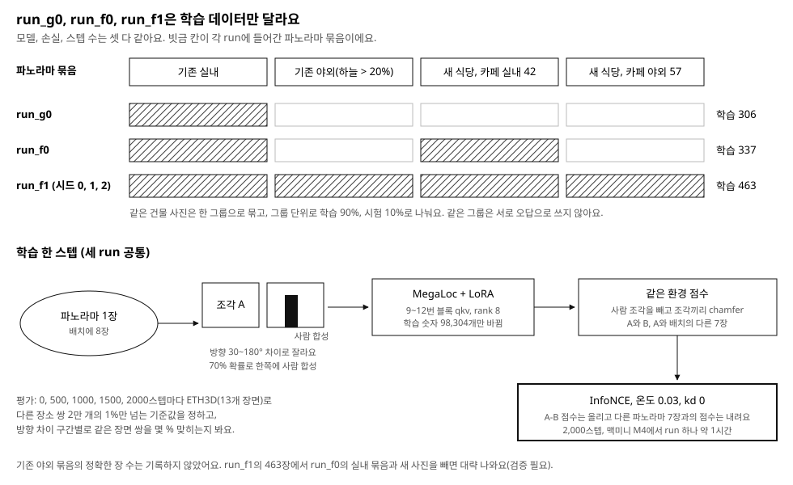
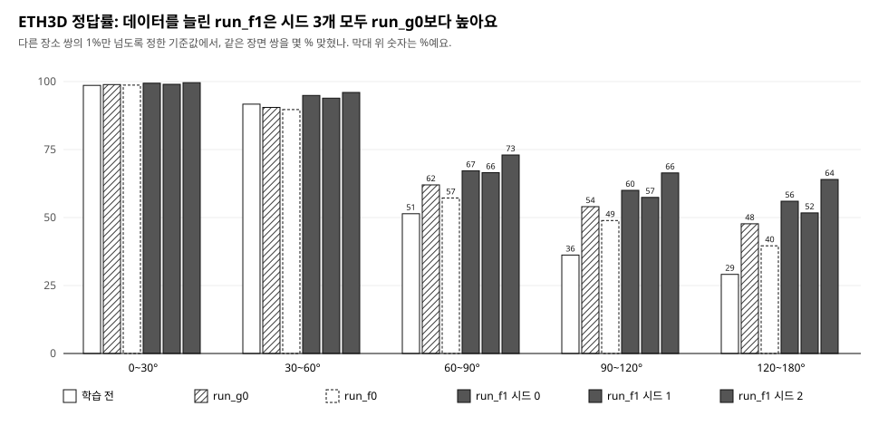
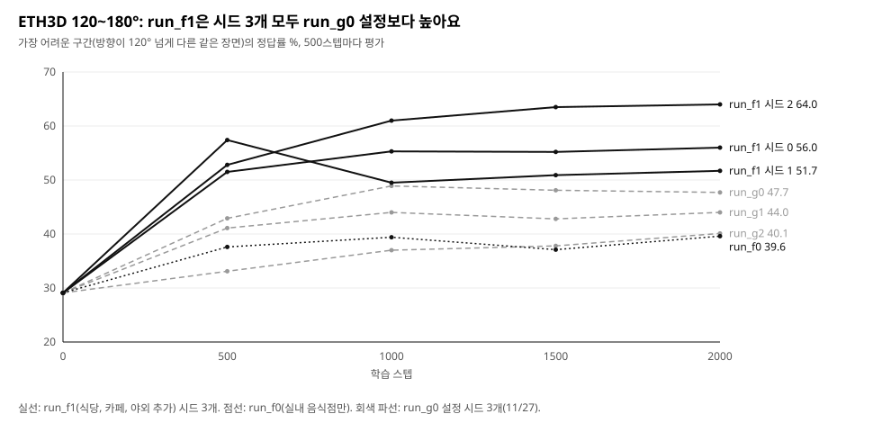
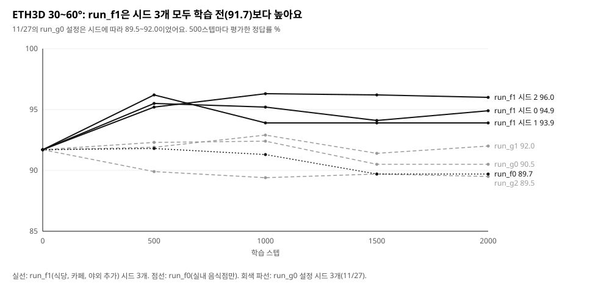
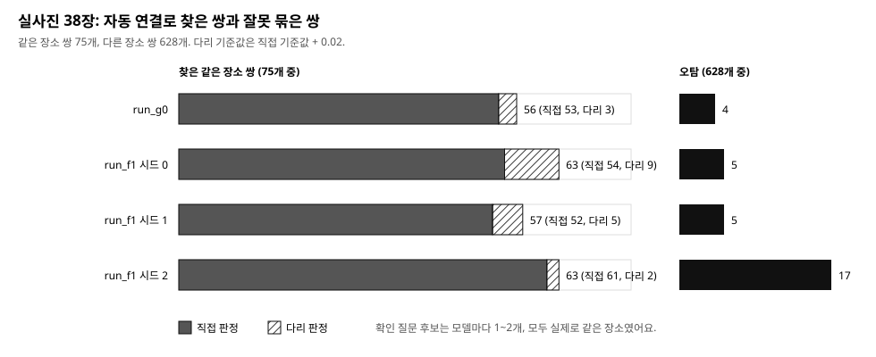
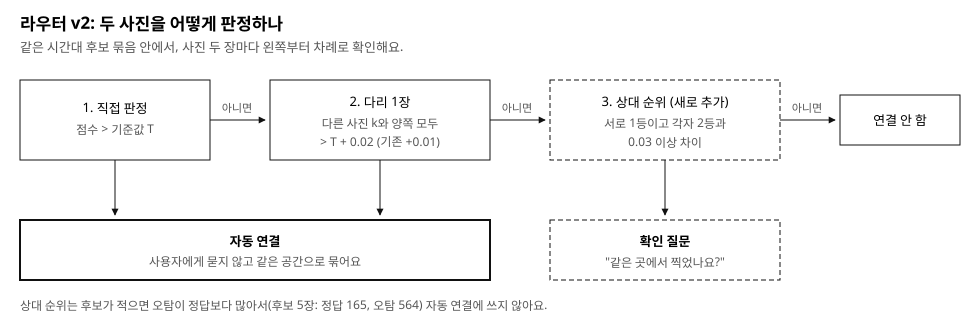

# 잇기: 학습 데이터 확장과 라우터 v2 (11/27~11/28)

[11/27 학습 기록](../2026-11-27-linking-env-score-lora/README.md)의 후속이에요. 그 문서의 "다음 학습"과 "남은 작업"을 이어서 했어요. 용어(같은 환경 점수, ETH3D, 기준값, 다리)는 그 문서를 따라요.

## 한눈에 보기

- 학습 데이터에 식당, 카페, 야외 파노라마를 넣은 **run_f1**이 ETH3D에서 지금까지 가장 좋아요. 시드 3개 모두 run_g0 설정의 시드 범위보다 높아서, 데이터 효과로 볼 수 있어요.
- 실사진에서는 시드마다 기준값이 달라져 결과가 흔들려요. 시드 2는 기준값이 낮게 잡혀 오탐이 많아요.
- 다리 기준값의 여유를 **+0.01에서 +0.02로** 올리면, run_f1 시드 0은 찾는 수를 그대로 두고 다리로 인한 오탐이 12건에서 0건이 돼요.
- 라우터에 **상대 순위 규칙**을 넣었어요. 후보가 적을 때 오탐이 많아서, 자동 연결이 아니라 "같은 곳에서 찍었나요?" **확인 질문 후보로만** 써요.
- 추천 모델을 run_g0에서 **run_f1 시드 0**으로 바꿔요. 다만 최종 확정 전에 새 실사진으로 한 번 더 확인해야 해요(아래 "최종 모델로 가도 되나").

## 1. 학습: 데이터를 늘린 run_f0, run_f1

### 왜 했나

11/27까지의 학습 파노라마 306장 가운데 식당, 카페, 술집은 4장뿐이었어요. 실사진은 대부분 그런 곳이라서, 학습과 실제 사용 장면이 맞지 않았어요.

### 데이터

| run | 학습 파노라마 | 시험 파노라마 | 무엇을 더했나 |
|---|---|---|---|
| run_g0 (기준) | 306 | 28 | 없음. 하늘이 20% 넘는 야외 파노라마는 뺐어요. |
| run_f0 | 337 | 39 | 식당, 카페 실내 파노라마 42장 |
| run_f1 | 463 | 48 | 식당, 카페 파노라마 99장(실내와 야외)과, 기존 묶음에서 빼 두었던 야외 파노라마 |

- 새 파노라마는 Wikimedia에서 자유 라이선스로 받았어요(`../2026-11-27-linking-env-score-lora/data_tools/`).
- run_f1은 `--outdoor 1`로 하늘 필터를 끄기 때문에, 새로 받은 99장뿐 아니라 기존 묶음의 야외 파노라마도 다시 들어가요. 그래서 run_f1의 효과가 음식점 데이터 덕인지, 야외 데이터 덕인지는 아직 나눠 보지 않았어요(검증 필요).
- 같은 건물 사진은 같은 그룹으로 묶어 학습과 시험에 나뉘지 않게 했어요.

### 설정

run_g0와 같아요. LoRA rank 8을 9~12번 블록 qkv에 붙이고(학습 숫자 98,304개), InfoNCE(온도 0.03), kd 0, 2,000스텝, 배치 8, 사람 합성 70%예요. 학습 코드는 `../2026-11-27-linking-env-score-lora/train/train_pano_f.py`, 시드를 바꿔 다시 돌린 스크립트는 `train/chain_f1_seeds.sh`예요. 맥미니(M4) 한 대에서 run 하나에 약 1시간 걸렸어요.

### ETH3D 결과

| run | 0~30° | 30~60° | 60~90° | 90~120° | 120~180° | 기준값 |
|---|---|---|---|---|---|---|
| 학습 전 | 98.6 | 91.7 | 51.4 | 36.2 | 29.1 | |
| run_g0 | 98.9 | 90.5 | 62.0 | 54.0 | 47.7 | .629 |
| run_f0 | 98.7 | 89.7 | 57.2 | 48.9 | 39.6 | .634 |
| run_f1 시드 0 | 99.4 | 94.9 | 67.2 | 60.0 | 56.0 | .611 |
| run_f1 시드 1 | 99.0 | 93.9 | 66.5 | 57.4 | 51.7 | .624 |
| run_f1 시드 2 | 99.6 | 96.0 | 73.0 | 66.4 | 64.0 | .587 |

- run_f1은 120~180° 평균이 57.2%예요. run_g0 설정은 시드에 따라 40.1~47.7%였어요.
- 30~60°는 11/27의 run_g0 설정에서 시드에 따라 89.5~92.0으로, 대체로 학습 전(91.7)보다 조금 낮았어요. run_f1은 세 시드 모두 93.9~96.0으로 학습 전보다 높아요.
- 실내 음식점만 넣은 run_f0는 오히려 낮아졌어요. 야외 데이터를 함께 넣은 것이 중요했던 것으로 보여요(검증 필요).
- 학습 중간값은 `results/eth3d_curves.json`에 있어요.

## 2. 실사진 평가

평가 사진은 11/27의 실사진 36장에, 같은 카페에서 찍은 2장(셀카 1장, 빈자리 1장)을 더한 38장이에요. 같은 장소 쌍은 75개, 다른 장소 쌍은 628개예요. 사진은 공개 저장소에 올리지 않고 숫자만 `results/real_eval.json`에 남겨요.

**자동 연결(직접 판정 + 다리 판정), 38장, 다리 여유 +0.02**

| run | 직접 판정 | 자동 연결 찾음 | 자동 연결 오탐 | 확인 질문 후보 |
|---|---|---|---|---|
| run_g0 | 53 | 56 | 4 | 1 (모두 정답) |
| run_f1 시드 0 | 54 | 63 | 5 | 2 (모두 정답) |
| run_f1 시드 1 | 52 | 57 | 5 | 2 (모두 정답) |
| run_f1 시드 2 | 61 | 63 | 17 | 2 (모두 정답) |

**36장에서 11/27 모델까지 함께 비교 (다리 여유 +0.01 / +0.02)**

| run | 찾음 (+0.01) | 오탐 (+0.01) | 찾음 (+0.02) | 오탐 (+0.02) |
|---|---|---|---|---|
| run_g0 | 58 | 6 | 56 | 4 |
| run_q0 (큐) | 66 | 11 | 57 | 8 |
| run_q1 (큐) | 70 | 84 | 67 | 44 |
| run_q2 (큐) | 65 | 4 | 52 | 2 |
| run_f0 | 56 | 0 | 49 | 0 |
| run_f1 시드 0 | 63 | 17 | 63 | 5 |
| run_f1 시드 1 | 59 | 8 | 57 | 5 |
| run_f1 시드 2 | 66 | 22 | 63 | 17 |

같은 장소 쌍 74개, 다른 장소 쌍 556개예요.

읽는 법
- 큐 학습은 시드마다 실사진 결과가 극단적으로 달라요(q1은 오탐 84, q2는 4). 그래서 계속 채택하지 않아요.
- run_f1 시드 0과 1은 run_g0보다 같거나 많이 찾고, 오탐은 1건 많아요.
- run_f1 시드 2의 오탐은 대부분 기준값(.587)이 낮아서 생겼어요. ETH3D만으로 정한 기준값이 시드마다 0.04 가까이 움직이는 것이 지금 가장 큰 약점이에요.
- run_f1 시드 0의 다리 오탐 12건은 펍과 식당 사이 5건, 서로 다른 식당 두 곳 사이 3건처럼 대부분 음식점끼리였어요. 음식점 데이터를 넣으면서 음식점끼리의 점수가 함께 올라간 것으로 보여요(검증 필요).

## 3. 라우터 v2

코드: `eval/router_v2.py`

### 다리 여유 +0.01에서 +0.02로

| 다리 기준값 | run_g0 찾음 | run_g0 오탐 | run_f1 시드 0 찾음 | run_f1 시드 0 오탐 |
|---|---|---|---|---|
| T + 0.01 | 58 | 6 | 63 | 17 |
| T + 0.02 | 56 | 4 | 63 | 5 |
| T + 0.03 | 53 | 4 | 56 | 5 |

run_f1에서는 +0.02가 찾는 수를 지키면서 다리 오탐만 없애요. 다만 이 값은 평가에 쓴 실사진을 보고 골랐어요. 같은 사진으로 고르고 평가했으니, 새 사진으로 다시 확인해야 해요.

### 상대 순위 규칙: 확인 질문 후보로만

**계기**: 같은 카페의 셀카와 빈자리 사진이 자동 연결되지 않았어요(run_g0 0.588, run_f1 0.586, 기준값 미달). 셀카에서는 액자가 머리에 가려지고 사람 부분은 점수에서 빠져서, 둘이 함께 보여 주는 것이 벽돌 벽과 선반 정도뿐이에요. 그래도 38장 안에서 두 사진은 서로 1등이었고 2등과 0.08 이상 차이가 났어요.

**규칙**: 후보 묶음 안에서 두 사진이 서로 1등이고, 각자의 2등과 0.03 이상 차이 나면 해당해요.

**후보가 적을 때의 시험** (`eval/small_pool_sim.py`, `results/small_pool_*.json`)

실제 앱은 촬영 시각으로 후보를 먼저 좁혀서 한 번에 몇 장만 비교해요. 그래서 38장에서 k장을 무작위로 뽑는 것을 2,000번 반복했어요. 아래는 run_g0에서 상대 순위 규칙이 판정한 쌍만 센 것이에요.

| 후보 수 | 맞게 찾음 | 잘못 묶음 |
|---|---|---|
| 3장 | 121 | 885 |
| 5장 | 165 | 564 |
| 8장 | 249 | 330 |

최소 점수를 0.58, 2등과의 차이를 0.05로 높여도 잘못 묶는 쌍이 비슷하거나 더 많았어요(후보 5장: 81 대 104). 같은 시험에서 직접 판정과 다리 판정의 오탐률은 약 0.6%였어요.

**결정 (11/28)**: 자동 연결에는 쓰지 않고 "같은 곳에서 찍었나요?" 확인 질문 후보로만 써요. 잘못 묶여도 사용자가 거를 수 있고, 셀카처럼 점수가 낮은 같은 장소 쌍을 놓치지 않게 해 줘요. 그래서 11/27의 "셀카처럼 배경이 거의 없는 사진은 후보에서 뺀다"는 규칙은 이 질문으로 바꿔요.

## 최종 모델로 가도 되나

**결론: run_f1 시드 0을 다음 단계(앱 연결, 시연)의 기본 모델로 써도 돼요. 다만 "최종 확정"은 새 실사진 확인 뒤에 해요.**

| 항목 | 판단 |
|---|---|
| 데이터 효과 | 확인됨. 시드 3개 모두 ETH3D에서 run_g0 설정보다 높아요. |
| 실사진 성능 | run_g0보다 7쌍 더 찾고 오탐은 1건 많아요(63/5 대 56/4). |
| 시드 선택 | 시드 2는 기준값이 낮아 오탐이 많아서 쓰지 않아요. 시드 0과 1 가운데 0을 고른 것은 같은 실사진을 보고 한 것이라, 새 사진 확인이 필요해요. |
| 다리 여유 +0.02 | 같은 실사진으로 골랐어요. 새 사진 확인이 필요해요. |
| 확정 전 할 일 | 학습에 쓰지 않고 지금까지 보지 않은 실사진(장소 5곳 이상, 야외 포함)으로 run_f1 시드 0과 run_g0을 한 번 비교해요. 여기서도 run_f1이 같거나 나으면 확정해요. |

**권하는 설정**
- 모델: run_f1 시드 0(LoRA, 큐 없음, 식당, 카페, 야외 데이터 포함)
- 점수: 같은 환경 점수, 사람 조각 제외
- 자동 연결: 직접 점수 > 0.611, 아니면 다리 1장(두 다리 모두 > 0.631)
- 확인 질문: 상대 순위 규칙에 해당하는 쌍

## 남은 작업

- [ ] 보지 않은 실사진(야외 포함)으로 run_f1 시드 0과 run_g0 최종 비교
- [ ] 기준값을 시드에 덜 흔들리게 정하기. 예를 들어 ETH3D와 파노라마 시험셋의 오답 점수를 함께 써서 정해요.
- [ ] run_f1 효과 나누기: 야외만 넣은 학습과 음식점만 넣은 학습을 비교해요.
- [ ] 셀카처럼 사람이 화면 대부분을 가리는 학습 쌍을 늘릴지 검토해요.

## 파일

| 경로 | 내용 |
|---|---|
| `eval/router_v2.py` | 직접, 다리, 확인 질문 판정 |
| `eval/small_pool_sim.py` | 후보 수를 줄인 시뮬레이션 |
| `train/chain_f1_seeds.sh` | run_f1 시드 1, 2 학습 |
| `results/eth3d_curves.json` | run_f0, run_f1 세 시드의 학습 중 ETH3D 결과 |
| `results/real_eval.json` | 모델별 실사진 판정 수(사진과 사진 이름 없음) |
| `results/small_pool_g0.json`, `results/small_pool_f1s0.json` | 시뮬레이션 결과 |
| `figures/` | 이 문서의 그림 |

실사진 점수 계산은 `../2026-11-27-linking-env-score-lora/eval/score_real_pairs.py`에서 체크포인트 경로만 바꿔서 했어요. 체크포인트와 실사진은 저장소에 넣지 않아요.
