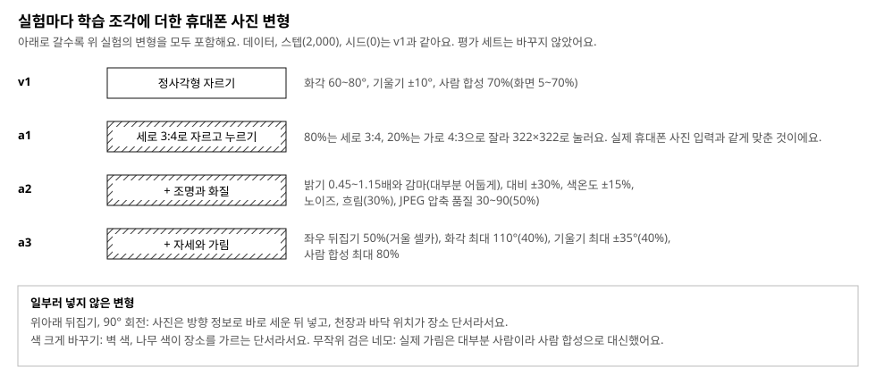
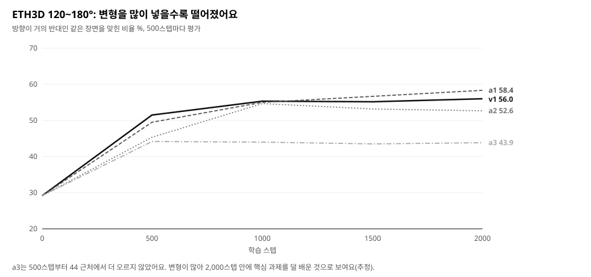
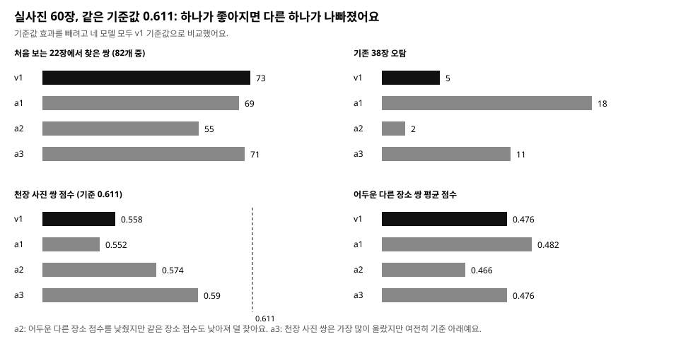

# 잇기: 휴대폰 사진 변형(augmentation) 학습 실험 (11/28)

확정 모델 v1([ml/linking/v1](../../linking/v1/README.md))에 휴대폰 사진처럼 보이게 하는 변형을 더해 다시 학습했어요. 실제 사진에서 생기는 실패를 줄일 수 있는지 확인하려는 실험이에요.

## 한눈에 보기

- **결론**: 어떤 변형도 v1을 확실히 넘지 못해 **v1을 그대로 써요.**
- **실험마다 결과가 엇갈렸어요.**
    - a2는 오탐을 줄였지만 같은 장소도 덜 찾았어요.
    - a3는 천장 사진처럼 어려운 쌍의 점수를 올렸지만, 공개 평가(ETH3D)가 크게 떨어졌어요.
- **전체 구분력은 그대로였어요.**
    - 기준값과 상관없는 구분력(AUC)은 네 모델 모두 0.984~0.985예요.
    - 변형은 전체 실력을 바꾸지 못했어요. 어떤 쌍의 점수는 올리고 어떤 쌍은 내리는 쪽으로만 작용했어요.
- **"어두우면 a2로 바꿔 끼우기"도 시험했어요.**
    - 오탐은 1건 줄었지만 계산이 2배로 늘어나서 보류했어요.
    - v1의 오탐은 아주 어두운 사진이 아니라 "노란 조명에 나무 테이블이 있는 비슷한 식당"끼리 생겨요.

## 1. 왜 했나

v1 실사진에서 이런 약점이 보였어요.
- 천장을 올려다본 사진이 같은 식당의 다른 사진과 이어지지 않았어요.
- 오탐 대부분이 어두운 식당과 술집끼리였어요.
- 거울 셀카, 사람이 화면 대부분을 가린 포토부스 사진은 기준값을 겨우 넘었어요(여유 0.02).
- 코드를 보다가 **학습과 실제 입력이 다른 점**도 찾았어요.
    - 실제 휴대폰 사진(세로 3:4)은 322×322 정사각형으로 눌러서 넣어요.
    - 학습 조각은 처음부터 정사각형으로 잘라서 눌림이 없었어요.

## 2. 어떻게 학습했나

| 실험 | 추가한 변형 | 노린 문제 |
|---|---|---|
| a1 | 80%는 세로 3:4, 20%는 가로 4:3으로 자른 뒤 322×322로 누르기 | 학습과 실제 입력의 차이 |
| a2 | a1 + 밝기와 감마(대부분 어둡게), 대비, 색온도, 노이즈, 흐림, JPEG 압축 | 어두운 식당 오탐 |
| a3 | a2 + 좌우 뒤집기, 화각 최대 110°, 기울기 최대 ±35°, 사람 합성 최대 80% | 거울 셀카, 천장 사진, 큰 가림 |

- 나머지 설정은 v1(run_f1)과 똑같아요.
    - 파노라마 463장, LoRA rank 8(9~12번 블록)
    - InfoNCE(온도 0.03), kd 0, 2,000스텝, 시드 0
- 변형은 학습 조각에만 넣었고, 평가 세트는 v1과 같아요.
- 정답 쌍 두 장에 변형이 **각각 따로** 들어가요. 그래서 한쪽만 어둡거나 한쪽만 뒤집힌 쌍도 생겨요.
- 학습 코드는 `scripts/patch_a.py`로 `train_pano_f.py`에서 `train_pano_a.py`를 만들어요(`--aug 1~3`).
- 맥미니 M4에서 하나에 약 1시간 걸렸어요(`scripts/chain_a.sh`).
- 위아래 뒤집기, 90° 회전, 색 크게 바꾸기는 일부러 넣지 않았어요. 실제 휴대폰 사진에서 생기지 않고, 장소 단서(천장과 바닥 위치, 벽 색)를 지우기 때문이에요.

## 3. 결과

### ETH3D (%)

| 모델 | 30~60° | 60~90° | 90~120° | 120~180° | 기준값 |
|---|---|---|---|---|---|
| v1 | 94.9 | 67.2 | 60.0 | 56.0 | 0.611 |
| a1 | 94.8 | 66.9 | 60.1 | 58.4 | 0.600 |
| a2 | 94.3 | 64.1 | 56.3 | 52.6 | 0.605 |
| a3 | 94.0 | 60.9 | 50.5 | 43.9 | 0.617 |

### 실사진 60장

실사진 60장은 기존 38장과 처음 보는 22장으로 나뉘어요. 다리 기준값은 직접 기준값 + 0.02예요.

**각 모델 자체 기준값**

| 모델 | 기존 38장 찾음 (75개 중) | 기존 38장 오탐 | 처음 22장 찾음 (82개 중) | 처음 22장 오탐 |
|---|---|---|---|---|
| v1 | 63 | 5 | 73 | 0 |
| a1 | 64 | 31 | 76 | 0 |
| a2 | 52 | 4 | 70 | 0 |
| a3 | 57 | 9 | 64 | 0 |

**같은 기준값 0.611 (기준값 효과를 뺀 비교)**

| 모델 | AUC | 기존 38장 찾음 | 기존 38장 오탐 | 처음 22장 찾음 | 천장 사진 쌍 | 카페 두 자리 쌍 |
|---|---|---|---|---|---|---|
| v1 | 0.9836 | 63 | 5 | **73** | 0.558 | 0.565 |
| a1 | 0.9839 | 62 | 18 | 69 | 0.552 | 0.568 |
| a2 | 0.9854 | 49 | **2** | 55 | 0.574 | 0.549 |
| a3 | 0.9854 | 58 | 11 | 71 | **0.590** | 0.555 |

같은 장소를 같은 수만큼 찾도록 기준을 맞춰도 오탐은 비슷했어요.

| 찾은 같은 장소 쌍 | v1 | a1 | a2 | a3 |
|---|---|---|---|---|
| 100쌍일 때 오탐 | 4 | 5 | 6 | 7 |
| 120쌍일 때 오탐 | 18 | 15 | 14 | 17 |

## 4. 왜 이렇게 됐나

**a1: 좋아 보인 점은 대부분 기준값 효과 (검증함)**
- a1 자체 기준값(0.600)에서는 처음 보는 사진을 76쌍 찾아 v1보다 좋아 보였어요.
- 같은 기준값 0.611로 놓으면 69쌍으로 오히려 줄었어요. ETH3D로 정한 기준값이 0.011 낮아진 효과였어요.
- 어두운 다른 장소 쌍의 평균 점수가 조금 올라서(0.476 → 0.482), 비슷한 식당끼리 다리로 이어지며 오탐이 늘었어요.

**a2: 오탐은 줄었지만 같은 장소도 덜 찾음 (검증함)**
- 어두운 다른 장소 쌍 평균 점수가 0.476에서 0.466으로 내려가 오탐이 줄었어요.
- 같은 장소 쌍 평균 점수도 0.709에서 0.701로 내려갔어요. 그래서 처음 보는 사진에서 찾은 쌍이 73쌍에서 55쌍으로 줄었어요.
- 조명이 달라도 같은 곳으로 보도록 학습하면서 조명과 색 정보를 덜 쓰게 된 것으로 보여요(추정). 실제 사진에서는 조명과 색도 장소 단서예요.

**a3: 노린 쌍은 나아졌지만 일반 성능 하락**
- 천장 사진 쌍 점수가 0.558에서 0.590으로 네 모델 중 가장 많이 올랐어요. 기울기와 큰 가림 변형의 효과예요. 하지만 기준값 0.611에는 여전히 못 미쳐요.
- ETH3D 120~180°는 56.0에서 43.9로 떨어졌고, 500스텝부터 44 근처에서 더 오르지 않았어요.
- 변형이 많아 학습 과제가 어려워져, 2,000스텝 안에 핵심 과제를 덜 배운 것으로 보여요(추정, 더 길게 학습해 확인해야 해요).
- 좌우 뒤집기는 "문은 왼쪽, 창은 오른쪽" 같은 배치 단서도 지워요.

## 5. 추가 시험: 어두우면 a2로 바꿔 끼우기

사진 밝기(사람을 뺀 부분 평균)에 따라 v1 대신 a2 점수를 쓰는 방식을 시험했어요. 기준값은 0.611이에요.

| 방식 | 기존 38장 찾음 | 기존 38장 오탐 | 처음 22장 찾음 |
|---|---|---|---|
| v1 그대로 | 63 | 5 | 73 |
| 두 사진 모두 어두우면(하위 35%) a2 | 63 | 4 | 73 |
| 하나라도 어두우면 a2 | 51~59 | 2~4 | 73 |
| v1과 a2 점수 평균 | 57~63 | 5 | 68~71 |

**효과가 작은 이유 (검증함)**
- v1의 오탐 5쌍은 밝기 순위로 60장 중 8~27위인 중간 밝기 사진끼리였어요. 노란 조명에 나무 테이블이 있는 비슷한 식당들이에요.
- 가장 어두운 사진끼리의 다른 장소 쌍 179개 중 v1이 기준값을 넘긴 것은 1개뿐이었어요. v1도 진짜 어두운 사진은 잘 구분해요.
- a2는 이 오탐 쌍들의 점수를 0.003~0.028 낮추지만, 2쌍은 여전히 기준값 위에 남아요.

**보류한 이유**
- 사진마다 모델 두 개로 특징을 뽑아야 해서 계산이 최대 2배예요.
- "어둡다"의 기준을 같은 60장을 보고 정하게 돼 과적합 위험이 있어요.
- 기준값을 모델마다 따로 관리해야 해요.

## 6. 결론과 다음

- v1을 유지해요. 변형 실험 모델은 쓰지 않아요.
- 진짜 문제는 "비슷한 분위기의 다른 식당"이에요. 밝기 변형보다는 이런 사진을 일부러 오답으로 넣어 학습하는 편이 더 직접적이에요(검증 필요).
- 천장 사진, 큰 셀카처럼 겹치는 배경이 적은 쌍은 변형만으로 기준값을 넘기기 어려웠어요. 지금은 확인 질문으로 보여 줘요. 팀원 테스트 페이지에서도 "같은 곳일 수도 있어요" 짝으로 보여 줘요.

**한계**
- 시드가 실험마다 1개라 몇 쌍 차이는 우연일 수 있어요.
- 실사진이 60장뿐이에요.
- a3를 더 길게 학습하면 결과가 달라질 수 있어요.

## 파일

| 경로 | 내용 |
|---|---|
| `scripts/patch_a.py` | `train_pano_f.py`에 `--aug 1~3` 변형을 넣어 `train_pano_a.py`를 만들어요 |
| `scripts/chain_a.sh` | a1, a2, a3를 차례로 학습 |
| `scripts/eval_a.sh` | 학습이 끝날 때마다 실사진 60장 점수 계산 |
| `scripts/analyze_aug.py` | 모델 비교, 원인 분석, 바꿔 끼우기 시험 |
| `results/eth3d_curves.json` | v1, a1~a3의 학습 중 ETH3D 결과 |
| `results/real_eval.json` | 실사진 비교 숫자(사진과 사진 이름 없음) |
| `figures/` | 이 문서의 그림 |

실사진, 사진 이름, 변형 샘플 사진(사람 합성 원본 포함), 가중치는 저장소에 넣지 않아요.
