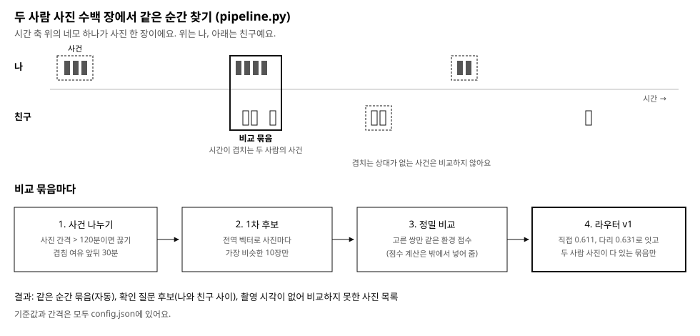
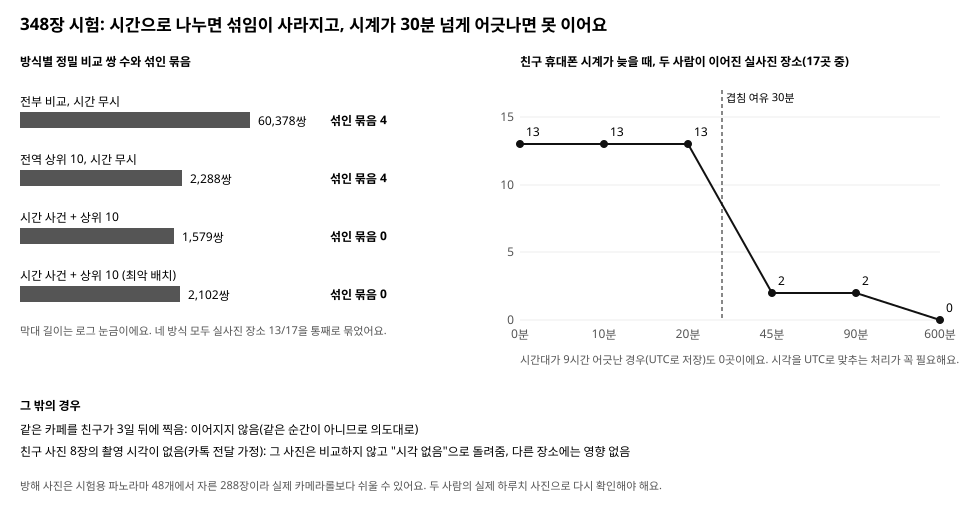

# 잇기: 두 사람 사진 수백 장 처리 방식 검증 (11/28)

잇기는 나와 친구의 사진첩에서 같은 순간을 찾아요. 실제로는 각자 수백 장씩 비교해야 해요. 이 실험에서는 확정 모델 v1([ml/linking/v1](../../linking/v1/README.md))을 수백 장에 어떻게 돌릴지 정하고, 그 흐름을 `ml/linking/v1/pipeline.py`로 만들었어요.

## 한눈에 보기

- **결론**: 촬영 시각으로 사건을 나누고, 두 사람의 사건이 겹치는 곳에서만, 사진마다 비슷한 10장만 정밀 비교해요.
- **결과**: 348장 시험에서 이 방식은 정확도를 그대로 지켰어요.
    - 다른 장소가 섞인 묶음은 4개에서 0개로 줄었어요.
    - 정밀 비교할 쌍은 나와 친구 사이 전체 30,275쌍의 5~7%(1,579~2,102쌍)로 줄었어요.
- **꼭 필요한 처리**: 두 사람의 촬영 시각을 같은 기준(UTC)으로 맞춰야 해요. 친구 시계가 45분 넘게 어긋나면 대부분 이어지지 않았어요.
- **남은 확인**: 방해 사진이 실제 카메라롤이 아니에요. 두 사람의 실제 하루치 사진으로 다시 확인해야 해요.

## 1. 왜 했나

- 다 비교하는 것 자체는 가능해요. 맥미니 M4에서 잰 속도는 아래와 같아요.

| 단계 | 처리 속도 | 나 300장, 친구 300장일 때 |
|---|---|---|
| 사진마다 특징 뽑기 | 41ms/장 | 약 25초 |
| 같은 환경 점수 (반정밀도) | 0.28ms/쌍 | 나와 친구 사이 9만 쌍이면 약 25초 |
| 특징 저장 | 약 0.8MB/장 | 약 490MB |

- 문제는 정확도예요. 비교 묶음이 크면 잘못된 쌍이 사슬처럼 이어져 다른 가게끼리 한 묶음이 돼요. 실사진 60장을 한 번에 돌렸을 때 어두운 식당과 술집 4곳이 한 묶음이 됐어요.

## 2. 처리 흐름

1. **사건 나누기**: 각자의 사진을 촬영 시각순으로 놓고, 간격이 120분을 넘으면 새 사건으로 끊어요.
2. **비교 묶음**: 내 사건과 친구 사건의 시간이 앞뒤 30분 여유 안에서 겹치면 하나로 합쳐요. 한 사람 사진만 있는 묶음은 같은 순간이 될 수 없으니 버려요.
3. **1차 후보**: 비교 묶음 안에서 사진마다 전역 벡터(MegaLoc 8,448차원, 특징 뽑을 때 함께 나와요)가 가장 비슷한 10장을 골라요. 다리 판정에 필요하므로 같은 사람 사진끼리도 골라요.
4. **정밀 비교**: 고른 쌍만 같은 환경 점수를 계산해요. 계산 함수는 밖에서 넣어 주므로 서버나 기기 어디서든 같은 흐름을 써요.
5. **판정**: 라우터 v1 규칙(직접 0.611, 다리 0.631)으로 잇고, 두 사람의 사진이 모두 들어간 묶음만 "같은 순간"으로 내요. 자동으로 안 이어진 나와 친구 사이 쌍 중 상대 순위 규칙에 맞는 것은 확인 질문 후보로 내요.
6. 촬영 시각이 없는 사진은 비교하지 않고 따로 돌려줘요.

간격, 여유, 후보 수는 `ml/linking/v1/config.json`의 `pipeline`에 있어요.

## 3. 시험 자료

| 자료 | 장수 | 설명 |
|---|---|---|
| 실사진 | 60 | 지금까지 모은 실사진. 17곳, 정답(같은 장소) 표시가 있어요. |
| 방해 사진 | 288 | 학습에 쓰지 않은 시험 파노라마 48개에서 6장씩 잘랐어요(시야 70°, 방향 무작위). 식당, 카페, 교회 등이에요. |
| 합계 | 348 | 사진 쌍 12만 개를 맥미니에서 34초에 모두 계산해 두고 방식별로 비교했어요. |

- **두 사람 나누기**: 장소마다 사진을 번갈아 나와 친구에게 나눠 줬어요.
- **촬영 시각**: 실사진은 원본 파일의 시각을 썼어요. 원본 시각을 모르는 장소는 3일 간격으로 임의 시각을 넣었어요. 실제 시각은 개인 정보라 저장소에 넣지 않아요(`times_private.json`).
- **방해 사진 시각**은 두 가지로 넣었어요.
    - 무작위: 6~11월 아무 때나
    - 최악: 실제 사건과 같은 시간대(앞뒤 90분)에 몰아넣기

## 4. 결과

### 방식별 비교 (348장 한 묶음, 시간 무시)

| 방식 | 정밀 비교 쌍 | 실사진 장소 통째로 | 파노라마 장소 통째로 | 다른 장소 섞인 쌍 | 섞인 묶음 |
|---|---|---|---|---|---|
| 전부 비교 | 60,378 | 13 / 17 | 20 / 26 | 534 | 4 |
| 전역 상위 5 | 1,067 | 12 / 17 | 20 / 26 | 54 | 3 |
| **전역 상위 10** | **2,288** | **13 / 17** | **20 / 26** | 534 | 4 |
| 전역 상위 15, 20, 30 | 3,508~7,217 | 13 / 17 | 20 / 26 | 534 | 4 |

- 상위 10부터는 전부 비교와 결과가 똑같아요. 상위 5는 실사진 장소 하나를 놓쳤어요.
- 시간을 무시하면 생기는 섞인 묶음 4개는 다음과 같아요.
    - 어두운 식당과 술집 4곳
    - 비슷한 교회 두 곳
    - 미국 식당 두 곳
    - 흰 벽돌 카페 1장과 호텔 입구

### 두 사람 처리 흐름 (`pipeline.py`)

| 방해 사진 시각 | 사건 간격 | 비교 묶음 | 정밀 비교 쌍 | 실사진 장소 통째로 | 섞인 순간 | 확인 질문 (정답) |
|---|---|---|---|---|---|---|
| 무작위 | 60분 | 43 | 1,548 | 13 / 17 | 0 | 4 (4) |
| 무작위 | 120분 | 42 | 1,579 | 13 / 17 | 0 | 4 (4) |
| 무작위 | 240분 | 38 | 1,654 | 13 / 17 | 0 | 4 (4) |
| 최악 | 60분 | 20 | 2,051 | 13 / 17 | 0 | 4 (4) |
| 최악 | 120분 | 17 | 2,102 | 13 / 17 | 0 | 3 (3) |
| 최악 | 240분 | 16 | 2,107 | 13 / 17 | 0 | 3 (3) |

- 정밀 비교 쌍은 나와 친구 사이 전체 30,275쌍의 5~7%예요.
- 판정 계산은 0.01초 안쪽이에요. 시간 대부분은 사진마다 특징을 뽑는 데 써요.
- 통째로 묶이지 않은 실사진 4곳은 시간을 무시하고 전부 비교해도 묶이지 않던 곳이에요.
    - 흰 벽돌 카페, 카페 09와 10: 확인 질문 후보로 잡혀요.
    - 나무 인테리어 가게, 장소 q02: 원래부터 점수가 낮았던 쌍이에요.

### 시각 기준이 깨지는 경우 (`test_risks.py`, 무작위, 간격 120분)

| 경우 | 두 사람이 이어진 실사진 장소 (17곳 중) | 섞인 순간 |
|---|---|---|
| 기본 | 13 | 0 |
| 친구 시계가 10분, 20분 늦음 | 13 | 0 |
| 친구 시계가 45분, 90분 늦음 | 2 | 0 |
| 친구 시계가 600분 늦음 | 0 | 0 |
| 친구 사진만 시간대 9시간 어긋남(UTC로 저장) | 0 | 0 |
| 같은 카페를 친구가 3일 뒤에 찍음 | 12 (카페만 안 이어짐) | 0 |
| 식당, 카페의 친구 사진 8장에 촬영 시각 없음 | 11 (8장은 "시각 없음"으로 돌려줌) | 0 |

- 시계가 겹침 여유(30분)보다 많이 어긋나면 이어지지 않아요. 시간대는 반드시 UTC로 맞춰야 해요. 사진의 EXIF에 있는 시간대 정보(OffsetTimeOriginal)를 쓰는 것을 권해요(검증 필요).
- 같은 장소를 다른 날 찍은 사진은 이어지지 않아요. "같은 순간"을 찾는 목적에는 맞지만, "너도 여기 왔었네" 같은 기능을 원한다면 따로 설계해야 해요(아래 검토 중인 결정).
- 카톡 등으로 받은 사진은 촬영 시각이 지워질 수 있어요. 그런 사진이 많으면 다른 처리가 필요해요.

## 5. 한계와 다음 확인

1. 방해 사진이 파노라마 조각이라 사람이 없고, 휴대폰 사진과 분위기가 달라요. 실제 카메라롤은 더 헷갈릴 수 있어요.
2. 실사진 중 일부는 촬영 시각을 임의로 넣었어요.
3. 대부분 한 휴대폰의 사진이에요. 두 기기의 시계 차이, 시간대 저장 방식은 실제 자료로 확인해야 해요.
4. **다음 확인**: 두 사람이 같은 날 각자 찍은 사진 전체(하루치)로 `pipeline.py`를 돌려 봐요. 팀원 테스트 페이지를 "내 사진, 친구 사진" 두 칸으로 바꾸면 팀원들이 직접 확인할 수 있어요.

## 검토 중인 결정

- **같은 장소, 다른 날**: 지금 흐름은 같은 순간만 이어요. "나도 이때 여기 갔었는데, 너도 갔었네" 같은 연결을 보여 줄지는 제품 결정이 필요해요. 보여 준다면 다음처럼 할 수 있어요.
    - "같은 순간"과 섞지 않고 별도 결과로 분리해요.
    - 사건을 넘어 비교하므로 비교 묶음이 커져요. 사슬 오류를 막으려면 직접 판정만 쓰고 기준값을 더 높게 잡는 편이 안전해요(검증 필요).
- **비교할 사진 수**: 공용 메모리의 첫 베타 설계는 "각자 10~20장 고르기"예요. 사진첩 전체(수백 장)를 비교할지는 아직 정해지지 않았어요. 이 실험은 수백 장도 처리할 수 있다는 근거예요.

## 파일

| 경로 | 내용 |
|---|---|
| `scripts/stress_feats.py` | 맥미니에서 348장 특징과 전체 점수 계산 |
| `scripts/analyze.py` | 방식별 비교, 시간 사건 시험 |
| `scripts/test_pipeline.py` | `pipeline.py`를 두 사람으로 나눠 시험 |
| `scripts/test_risks.py` | 시계 어긋남, 다른 날, 시각 없음 시험 |
| `results/*.txt` | 위 스크립트 출력 |
| `figures/` | 이 문서의 그림 |

실사진, 실제 촬영 시각, 점수 행렬(`stress.npz`)은 저장소에 넣지 않아요.
