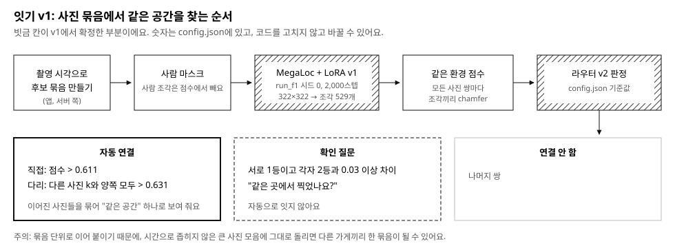
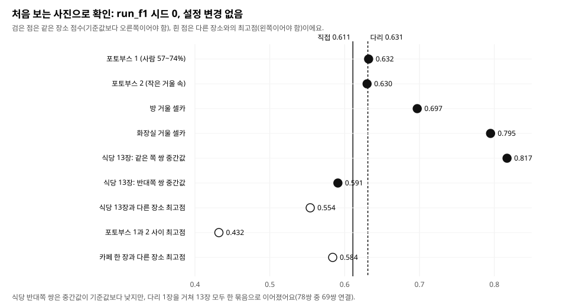

# 잇기 같은 공간 판정 모델 v1

2026-11-28에 확정한 잇기의 "같은 공간" 판정 모델과 설정이에요. 두 사람이 따로 찍은 사진이 같은 공간에서 찍혔는지를 판정해요. 학습 과정은 [11/27 기록](../../experiments/2026-11-27-linking-env-score-lora/README.md)과 [11/28 기록](../../experiments/2026-11-28-linking-food-data-router/README.md)에 있어요.

## 한눈에 보기

- **모델**: MegaLoc에 LoRA를 붙여 학습한 run_f1 시드 0 (2,000스텝)
- **설정**: 직접 판정 0.611, 다리 판정 0.631, 확인 질문은 서로 1등이고 2등과 0.03 이상 차이. 모두 `config.json`에 있어요.
- **확정 근거**
    - ETH3D 공개 평가에서 같은 설정으로 학습한 시드 3개가 모두 기존 모델(run_g0)보다 좋았어요.
    - 실사진 38장에서 기존 모델보다 7쌍 더 찾았고, 오탐은 1건 많았어요.
    - 처음 보는 장소 6곳의 사진 22장을 설정을 바꾸지 않고 확인했어요. 같은 장소 사진은 모두 한 묶음으로 이어졌고, 다른 장소와 잘못 묶인 경우는 0건이었어요.
- **주의할 점**
    - 반드시 촬영 시각으로 좁힌 후보 묶음 안에서만 돌려요.
    - 사람이 화면 대부분을 가리면 점수가 기준값을 겨우 넘어요(여유 약 0.02).
    - 기준값은 실제 사진이 쌓이면 다시 맞춰요.

## 어떻게 동작하나



| 단계 | 하는 일 | 확정 값 |
|---|---|---|
| 1. 후보 묶음 | 촬영 시각이 가까운 사진끼리 묶어요. 앱이나 서버 쪽 일이에요. | (이 모델 범위 밖) |
| 2. 사람 마스크 | 사람 부분을 찾아 점수에서 빼요. 맥미니에서는 macOS Vision 사람 분할을 썼어요. | 조각의 절반 넘게 사람이면 제외 |
| 3. 특징 뽑기 | 사진을 322×322로 줄이고 14픽셀 조각 529개(23×23)의 특징을 뽑아요. | MegaLoc + LoRA v1 |
| 4. 같은 환경 점수 | 두 사진의 조각끼리 가장 비슷한 짝을 찾아 평균내요(chamfer). 사람 조각은 빼요. | |
| 5. 직접 판정 | 점수가 기준값보다 높으면 같은 공간이에요. | 0.611 |
| 6. 다리 판정 | 다른 사진 한 장이 두 사진 모두와 기준값보다 높게 이어지면 같은 공간이에요. 방향이 거의 반대인 사진을 이어 줘요. | 0.631 |
| 7. 확인 질문 | 위에서 안 이어졌지만 두 사진이 서로 1등이고 각자 2등과 0.03 이상 차이 나면, 사용자에게 "같은 곳에서 찍었나요?"라고 물어요. 자동으로 잇지 않아요. | 차이 0.03 |
| 8. 묶음 | 5, 6에서 이어진 사진들을 묶어 "같은 공간" 하나로 보여 줘요. | |

## 모델

| 항목 | 값 |
|---|---|
| 기반 모델 | MegaLoc (DINOv2 ViT-B/14 + 요약층), `model.safetensors` 915MB |
| 기반 모델 sha256 | `d4f9f2bcb60018f91eb6a8e061ed054fd55654e10c2569cf13841ea986ffb4f8` |
| LoRA 위치 | 9~12번 블록 attention qkv |
| LoRA 크기 | rank 8, alpha 16(배율 2.0), 학습 숫자 98,304개, 파일 397KB |
| LoRA sha256 | `79dea0b3dd39fd2df1e38380497910d08ccd071d6dc35cb1b99d56845248433a` |
| 학습 데이터 | 360° 파노라마 463장(Wikimedia, Poly Haven). 기존 실내, 기존 야외, 새 식당과 카페 99장 |
| 학습 방법 | 파노라마 한 장에서 방향이 30~180° 다른 조각 2장을 정답으로 하고, 70% 확률로 사람을 합성했어요. InfoNCE(온도 0.03), kd 0, 배치 8, 2,000스텝 |
| 학습 기록 | `train_report.json`(가중치와 같은 곳에 보관) |

**가중치 보관 위치**
- 가중치는 공개 저장소에 넣지 않아요(`.gitignore`에서 제외).
- 지금 보관된 곳은 두 군데예요.
    - 맥미니 `~/our-year-train/vt/run_f1/step2000.ckpt`
    - 팀장 MacBook의 프로젝트 폴더 `models/linking-v1/`
- 파일을 받으면 위 sha256 값과 같은지 먼저 확인해요.

## 왜 이 모델인가

### ETH3D (학습에 쓰지 않은 공개 데이터, 정답률 %)

| 모델 | 0~30° | 30~60° | 60~90° | 90~120° | 120~180° |
|---|---|---|---|---|---|
| 학습 전 MegaLoc | 98.6 | 91.7 | 51.4 | 36.2 | 29.1 |
| run_g0 (이전 추천) | 98.9 | 90.5 | 62.0 | 54.0 | 47.7 |
| **v1 (run_f1 시드 0)** | **99.4** | **94.9** | **67.2** | **60.0** | **56.0** |
| run_f1 시드 1, 2 | 99.0, 99.6 | 93.9, 96.0 | 66.5, 73.0 | 57.4, 66.4 | 51.7, 64.0 |

같은 설정의 시드 3개가 모두 run_g0 설정의 시드 범위(120~180°에서 40.1~47.7%)보다 높아요. 시드 운이 아니라 학습 데이터를 늘린 효과예요.

### 실사진 38장 (모델을 고를 때 쓴 사진)

| 모델 | 자동 연결로 찾은 같은 장소 쌍 (75개 중) | 오탐 (628개 중) | 확인 질문 후보 |
|---|---|---|---|
| run_g0 | 56 | 4 | 1 (정답) |
| **v1** | **63** | 5 | 2 (모두 정답) |

### 처음 보는 사진 (확정 전 확인, 설정 변경 없음)



| 장소 | 사진 | 어려운 점 | v1 결과 | run_g0 결과 |
|---|---|---|---|---|
| 식당 | 13장 | 벽 쪽 5장과 창문 쪽 8장이 서로 반대 방향 | 13장 모두 한 묶음, 78쌍 중 69쌍 연결 | 12장 한 묶음(천장 사진 1장 빠짐), 66쌍 |
| 포토부스 1 | 2장 | 사람이 57~74% 가림, 거울 셀카 | 0.632, 이어짐 | 0.673, 이어짐 |
| 포토부스 2 | 2장 | 한 장은 작은 거울 속에만 부스가 보임 | 0.630, 이어짐 | 0.638, 이어짐 |
| 방 | 2장 | 거울 셀카 | 0.697, 이어짐 | 0.711, 이어짐 |
| 화장실 | 2장 | 거울 셀카 | 0.795, 이어짐 | 0.821, 이어짐 |
| 카페 | 1장 | 짝이 없음. 아무것과도 이어지지 않아야 해요. | 최고 0.584, 안 이어짐 | 최고 0.606, 안 이어짐 |
| 다른 장소와 잘못 묶임 | | | 0건 | 0건 |

- 포토부스 두 곳 사이의 최고점은 0.432였어요. 같은 종류의 다른 가게를 같은 곳으로 착각하지 않았어요.
- 식당의 반대 방향 사진은 직접 점수(중간값 0.591)만으로는 기준값에 못 미쳐요. 다리 판정이 있어야 이어져요.

## 두 사람 사진 수백 장 처리 (`pipeline.py`)

나와 친구의 사진 전체를 넣으면 같은 순간 묶음을 돌려줘요. 자세한 검증은 [수백 장 처리 실험](../../experiments/2026-11-28-linking-scale-test/README.md)에 있어요.

1. 각자 사진을 촬영 시각으로 사건으로 나눠요(간격 120분).
2. 두 사람의 사건이 앞뒤 30분 안에서 겹치는 곳만 비교해요.
3. 사진마다 전역 벡터가 가장 비슷한 10장만 같은 환경 점수로 정밀 비교해요.
4. 라우터 v1로 잇고, 두 사람 사진이 모두 있는 묶음만 "같은 순간"으로 내요.

```python
from pipeline import Photo, link
photos = [Photo(id='a1', owner='a', time=촬영시각_분), ...]   # time은 UTC 기준, 없으면 None
res = link(photos, glob_vectors, score_fn)   # score_fn: [(i, j), ...] -> 같은 환경 점수 목록
res.moments, res.ask, res.no_time
```

- 348장 시험에서 다른 장소가 섞인 묶음은 0개였어요.
- 정밀 비교 쌍은 나와 친구 사이 전체의 5~7%로 줄었어요.
- 촬영 시각은 반드시 UTC로 맞춰서 넣어요. 두 기기의 시계가 45분 넘게 어긋나면 대부분 이어지지 않았어요.

## 팀원 테스트 페이지

팀원이 직접 사진을 올려 v1이 같은 공간을 잘 묶는지 볼 수 있는 웹 페이지예요(`demo/linking_demo.py`).

- **쓰는 법**
    - 링크를 열고 사진을 5장 안팎으로 한 번에 올린 뒤 **판정하기**를 눌러요.
    - 아이폰 HEIC 사진도 올릴 수 있어요. 설치나 로그인은 필요 없어요.
- **보여 주는 것**
    - 같은 공간 묶음과 묶음별 사진
    - 확인 질문 후보
    - 사진 쌍마다 점수와 판정, 사진별 사람 비율
- **동작 방식**
    - 맥미니에서 평가 때와 같은 순서(macOS Vision 사람 마스크, 같은 가중치, 같은 config.json)로 돌아요.
    - 사진 7장으로 확인해 보니 평가 점수와 최대 0.004 차이였고, 판정은 모두 같았어요. 차이는 사진 축소 도구가 달라서 생겨요.
- **공개 범위**
    - Gradio의 임시 공개 링크(`*.gradio.live`)를 써요. 링크를 아는 사람은 누구나 열 수 있고, 비밀번호는 걸지 않았어요(팀 결정).
    - 링크는 최대 1주 동안 유지돼요. 맥미니를 다시 켜거나 페이지를 다시 띄우면 주소가 바뀌어요.
- **사진 처리**: 올린 사진은 맥미니 임시 폴더에 잠시 남았다가 1시간 안에 자동으로 지워져요.
- **실행**: 맥미니에서 `cd ~/our-year-train/app && PYTHONUNBUFFERED=1 nohup ../.venv/bin/python linking_demo.py --share > demo.log 2>&1 &` 를 실행하고, 링크는 `demo.log`에서 확인해요. `config.json`과 `router.py`를 같은 폴더에 둬야 해요.

## 알려진 한계

1. **묶음은 후보 안에서만 만들어야 해요.** `pipeline.py`가 촬영 시각으로 후보를 나눠 이 문제를 막아요.
    - 시간으로 좁히지 않은 지금까지의 실사진 60장 전체에 돌리면, 어두운 식당과 술집 4곳이 한 묶음으로 이어져요.
    - 잘못된 쌍 5개(점수 0.616~0.631)가 사슬처럼 이어지기 때문이에요. run_g0도 같았어요.
    - 실제 앱에서는 같은 시간대에 다른 가게 두 곳이 섞이는 경우가 드물지만, 후보 묶음을 작게 유지해야 해요.
2. **사람이 많이 가리면 여유가 작아요.** 포토부스 두 쌍은 기준값보다 0.019~0.021만 높았어요.
3. **기준값이 학습 시드에 따라 흔들려요.** 같은 설정으로 다시 학습하면 기준값이 0.587~0.624로 달라졌어요. 모델을 다시 학습하면 기준값도 다시 확인해야 해요.
4. **야외 실사진은 아직 평가하지 않았어요.**
5. **사람 마스크는 macOS Vision으로 만들었어요.** 다른 사람 분할 모델을 쓰면 점수가 조금 달라질 수 있어요(검증 필요).

## 기준값을 바꾸는 법

- `config.json`의 `router` 값만 고쳐요. 코드는 그대로 둬요.
- 바꿀 때는 처음 보는 사진으로 확인한 결과를 PR에 함께 남겨요.
- 바꾼 값으로 평가 사진을 다시 돌려 오탐이 늘지 않았는지 봐요.

## 파일

| 경로 | 내용 |
|---|---|
| `config.json` | 확정 모델 정보(sha256)와 판정 기준값 |
| `pipeline.py` | 두 사람 사진 처리 흐름(사건 나누기, 1차 후보, 정밀 비교, 판정) |
| `router.py` | 점수 행렬을 받아 자동 연결, 확인 질문, 묶음을 돌려줘요. `python router.py scores.json` |
| `figures/v1_pipeline.svg` | 동작 순서 |
| `figures/heldout.svg` | 처음 보는 사진 결과 |
| `demo/linking_demo.py` | 팀원 테스트 웹 페이지(맥미니에서 실행) |

`router.py`는 11/28 실험의 `router_v2.py`와 같은 판정을 내요. 실사진 60장 점수로 두 코드의 결과가 모두 같은 것을 확인했어요. 점수 계산 코드는 `../../experiments/2026-11-27-linking-env-score-lora/eval/score_real_pairs.py`에 있어요. 실사진과 가중치는 저장소에 넣지 않아요.
